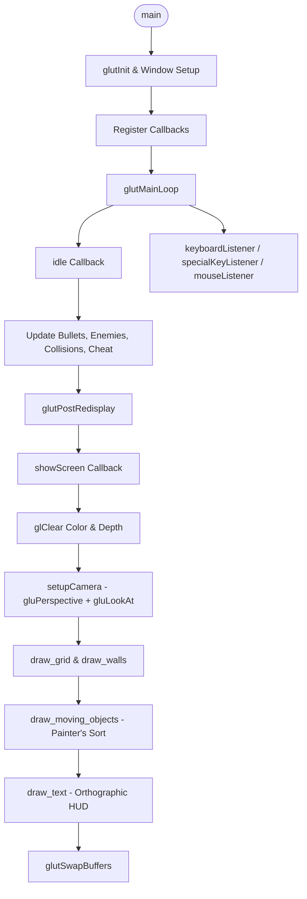

# CSE 423 Lab 3: "Bullet Frenzy" — Complete Viva & Code Guide

> **Prepared for:** CSE 423 (Computer Graphics) Lab 3 / Assignment 3 Viva  
> **Source File:** [`Assi3.py`](file:///Users/dhrubojyoti/Documents/Media/Books/BRACU/8th%20Semester/CSE423/LAB/Lab3/Assi3.py)  
> **Topic:** 3D Transformations, Projections, Camera Systems, and GLUT Event Architecture  

---

## 1. Project Overview & Rules Compliance

### What is "Bullet Frenzy"?
**Bullet Frenzy** is a real-time 3D arena survival game implemented in Python using PyOpenGL and GLUT.
- **Player:** Moves with **W/S**, turns/aims with **A/D**, fires cube bullets with **Left Mouse Button**.
- **Enemies:** 5 pulsating spheres constantly track and chase the player.
- **Rules & Scoring:**
  - Destroying an enemy gives **+1 Score** and respawns a new enemy.
  - Player starts with **5 Lives**; colliding with an enemy costs **1 Life**.
  - Missing **10 bullets** (bullets flying past arena boundaries) results in **Game Over**.
  - On Game Over, the player model falls backwards and lies on the floor; pressing **R** restarts.
- **Camera Views:**
  - **Third-Person (Orbit):** Controlled with Arrow keys (orbit angle and height).
  - **First-Person:** Toggled with **Right Mouse Button**; follows player aim; Up/Down arrows adjust camera height.
- **Cheat Mode:**
  - **C:** Toggles continuous 360° spin with auto-lock/auto-fire whenever an enemy enters the gun's line-of-sight.
  - **V:** Toggles first-person camera synchronization during cheat mode.

### Strict Assignment Constraints:
- **Zero Unapproved OpenGL Functions:** Uses strictly the functions given in [`3D_OpenGL_Intro.py`](file:///Users/dhrubojyoti/Documents/Media/Books/BRACU/8th%20Semester/CSE423/LAB/Lab3/3D_OpenGL_Intro.py).
- **No `glutTimerFunc`:** All real-time animation is driven inside `glutIdleFunc(idle)` using delta-time (`dt = now - last_time`) for frame-rate independence.

---

## 2. Core Architecture & Execution Flow



---

## 3. Detailed Component Breakdown

### A. Quadric Management (`get_quadric`)
```python
quadric = None
def get_quadric():
    global quadric
    if quadric is None:
        quadric = gluNewQuadric()
    return quadric
```
* **Viva Concept:** GLU uses quadric objects to render cylinders, spheres, and disks.
* **Why this is critical:** Calling `gluNewQuadric()` inside every frame (60+ times/second) causes massive **CPU/GPU memory leaks**. Storing a single global quadric instance and reusing it solves this completely.

---

### B. Arena Geometry: Floor Grid & Walls

#### 1. Dynamic Checkerboard Floor (`draw_grid`)
* Grid extends from `-GRID_LENGTH` to `+GRID_LENGTH` ($700 \times 700 \times 2 = 1400 \times 1400$ total area).
* Built using `GL_QUADS` in steps of `TILE = 100`.
* **Alternating Pattern Logic:**
  ```python
  if (i + j) % 2 == 0:
      glColor3f(1, 1, 1)          # White tile
  else:
      glColor3f(0.7, 0.5, 0.95)   # Light-purple tile
  ```
  The parity of `(i + j)` creates the 2D alternating chessboard grid.

#### 2. Arena Boundary Walls (`draw_walls`)
* 4 vertical quads of height `WALL_HEIGHT = 100`:
  - **Blue:** $y = +G$
  - **Cyan:** $x = +G$
  - **Green:** $y = -G$
  - **White:** $x = -G$

---

### C. 3D Hierarchical Player Model (`draw_player`)

The player is constructed from basic 3D geometric primitives using hierarchical transformations:

| Part | Primitive | Dimensions / Properties | Transformation / Positioning |
|---|---|---|---|
| **Legs (2)** | `gluCylinder` | Tapered: Base 5, Top 11, Height 50 | Left: `(0, -14, 0)`, Right: `(0, +14, 0)` |
| **Torso** | `cuboid` (Cube + Scale) | $18 \times 48 \times 50$ (narrow front-to-back, wide shoulders) | Centered at $Z = 75$ |
| **Gun** | `gluCylinder` | Base 8, Top 2, Length 70 | Centered at $Z = 75$, rotated $+90^\circ$ along Y to face forward ($+X$) |
| **Hands (2)**| `gluCylinder` | Base 8, Top 3, Length 40 | Left/Right shoulders at $Z = 80$, $Y = \pm 20$, rotated $+90^\circ$ along Y |
| **Head** | `gluSphere` | Radius 12 | Centered at $Z = 110$ (atop torso) |

#### Game Over Death Animation:
```python
if game_over:
    glTranslatef(player_x, player_y, 20)
    glRotatef(player_angle, 0, 0, 1)
    glRotatef(-90, 0, 1, 0)  # Pitch backwards 90 degrees to lie face-up
```

---

### D. Enemy Modeling & Pulsating Animation (`enemy_radius`, `draw_one_enemy`)

* **Hierarchical Anatomy:**
  1. **Body:** Red sphere (`gluSphere`) resting on the floor: center lifted to $Z = r$.
  2. **Head:** Smaller black sphere ($r \times 0.45$) stacked atop the body at $Z = r \times 0.9$.
* **Pulsating Breathing Formula:**
  $$r(t) = 40 + 8 \cdot \sin(2t + \text{phase})$$
  - Base radius = 40
  - Amplitude = $\pm 8$ (radius oscillates smoothly between 32 and 48)
  - Angular frequency = $2\text{ rad/s}$
  - `phase`: Random per enemy so they don't pulse synchronously.

---

### E. Camera Systems (`setupCamera`, `camera_position`)

OpenGL sets up the camera in the `GL_PROJECTION` and `GL_MODELVIEW` matrices:

#### 1. Projection Matrix (`GL_PROJECTION`)
```python
glMatrixMode(GL_PROJECTION)
glLoadIdentity()
gluPerspective(fovY, 1.25, 0.1, 3000.0)
```
- `fovY = 120`: Vertical field of view in degrees.
- `aspect = 1.25`: Aspect ratio (Window width / height = $1000 / 800 = 1.25$).
- `zNear = 0.1`: Near clipping plane.
- `zFar = 3000.0`: Far clipping plane.

#### 2. ModelView Matrix (`GL_MODELVIEW`) & `gluLookAt`
```python
gluLookAt(eyeX, eyeY, eyeZ,  centerX, centerY, centerZ,  upX, upY, upZ)
```

* **Third-Person Orbit View:**
  - Camera Eye: Spherical coordinates converted to Cartesian:
    $$eyeX = R \cdot \cos(\theta), \quad eyeY = R \cdot \sin(\theta), \quad eyeZ = \text{camera\_height}$$
  - Look-at Target: Center of arena `(0, 0, 0)`
  - Up Vector: `(0, 0, 1)` (+Z is vertical up)

* **First-Person Over-the-Head View:**
  - Positioned slightly behind and above the player's head:
    $$eyeX = \text{player\_x} - 28 \cdot \cos(\text{view\_angle})$$
    $$eyeY = \text{player\_y} - 28 \cdot \sin(\text{view\_angle})$$
    $$eyeZ = \text{fp\_height}$$
  - Target: Forward along line of sight `(player_x + 150*cos(view_angle), player_y + 150*sin(view_angle), eyeZ - 28)`.

---

### F. 2D HUD Text Rendering in 3D Space (`draw_text`)

To draw crisp 2D overlay text regardless of 3D camera angles:
1. Switch to `GL_PROJECTION`, push matrix, load `gluOrtho2D(0, 1000, 0, 800)`.
2. Switch to `GL_MODELVIEW`, push matrix, load identity.
3. Call `glRasterPos2f(x, y)` and render characters via `glutBitmapCharacter(font, ord(ch))`.
4. Pop both matrices to restore the 3D perspective camera for subsequent frames.

---

### G. Cheat Mode Auto-Aim Algorithm (`do_cheat`)

In cheat mode, the gun continuously rotates at $150^\circ/\text{s}$. To detect if an enemy is in the direct line of sight:

```python
ex = e["x"] - player_x
ey = e["y"] - player_y
dist = math.hypot(ex, ey)
r = enemy_radius(e, now)

# Exact geometric cone angle threshold
required_alignment = dist / math.hypot(dist, r)

# Dot product between unit enemy direction and unit gun direction
alignment = (ex / dist) * dx + (ey / dist) * dy

if alignment >= required_alignment:
    fire_bullet()
```

* **Mathematical Explanation:**
  - The enemy sphere with radius $r$ at distance $d$ subtends an angular half-width $\alpha$ where $\cos(\alpha) = \frac{d}{\sqrt{d^2 + r^2}}$.
  - The vector dot product $\hat{v}_{\text{enemy}} \cdot \hat{v}_{\text{gun}} = \cos(\theta)$, where $\theta$ is the angle between gun and enemy.
  - If $\cos(\theta) \ge \cos(\alpha)$, the gun ray is guaranteed to intersect the enemy sphere!

---

### H. Visibility & Painter's Algorithm (`draw_moving_objects`)

* **Why:** In strict compliance with the template, hardware depth testing (`glEnable(GL_DEPTH_TEST)`) is not called.
* **Solution:** Objects (player, enemies, bullets) are sorted by squared distance from the camera eye $(ex, ey, ez)$ in descending order:
  $$\text{dist}^2 = (x - ex)^2 + (y - ey)^2$$
* Farthest objects are drawn first, nearest objects are drawn last (Software Painter's Algorithm).

---

## 4. Top 20 Predicted Viva Questions & Answers

### Q1: What is the difference between `GL_PROJECTION` and `GL_MODELVIEW`?
> **Answer:**
> - `GL_PROJECTION` defines the camera lens/view frustum (e.g. perspective or orthographic projection, field of view, clipping planes).
> - `GL_MODELVIEW` defines object positions and orientation relative to the camera eye (translations, rotations, scaling, and camera placement via `gluLookAt`).

---

### Q2: Why do we use `glPushMatrix()` and `glPopMatrix()`?
> **Answer:**
> OpenGL maintains a matrix stack. `glPushMatrix()` saves a copy of the current transformation matrix, and `glPopMatrix()` restores it. This isolates transformations so that moving or rotating one body part (like an arm or gun) does not unintentionally affect other objects in the world.

---

### Q3: Why is matrix transformation order written in reverse in OpenGL?
> **Answer:**
> OpenGL uses **post-multiplication** ($v' = M \cdot v = M_1 \cdot M_2 \cdot M_3 \cdot v$). The last transformation specified in the code is applied *first* to the vertices of the object. For example:
> ```python
> glTranslatef(10, 0, 75)
> glRotatef(90, 0, 1, 0)
> gluCylinder(...)
> ```
> Here, the cylinder is first rotated $90^\circ$ around its local Y axis, and then translated into position.

---

### Q4: Why is `aspect` set to 1.25 in `gluPerspective(fovY, 1.25, 0.1, 3000.0)`?
> **Answer:**
> The aspect ratio is the ratio of window width to window height:
> $$\text{Aspect} = \frac{\text{Width}}{\text{Height}} = \frac{1000\text{ px}}{800\text{ px}} = 1.25$$
> If this ratio does not match the window dimensions, 3D objects will appear stretched or squashed.

---

### Q5: What do `zNear` and `zFar` do in `gluPerspective`?
> **Answer:**
> They define the near and far clipping planes of the view frustum. Geometry closer than `zNear` ($0.1$) or further than `zFar` ($3000.0$) is clipped and not rendered. `zNear` must always be $> 0$.

---

### Q6: How does `gluLookAt` work and what are its parameters?
> **Answer:**
> `gluLookAt(eyeX, eyeY, eyeZ, centerX, centerY, centerZ, upX, upY, upZ)` takes:
> 1. **Eye position:** Where the camera is located in world space.
> 2. **Target (center):** The 3D point the camera is looking directly at.
> 3. **Up vector:** Which direction is "up" for the camera (usually $+Z = (0, 0, 1)$).

---

### Q7: Why do we use `glutSwapBuffers()` instead of `glFlush()`?
> **Answer:**
> Because we enabled **Double Buffering** (`GLUT_DOUBLE`). In double buffering:
> - Drawing happens on an invisible back buffer.
> - `glutSwapBuffers()` swaps the back buffer with the front buffer when rendering is complete.
> This eliminates screen flickering and tearing during real-time animation.

---

### Q8: How did you implement real-time animation without `glutTimerFunc`?
> **Answer:**
> By registering an idle callback (`glutIdleFunc(idle)`). In `idle()`, we calculate delta time ($\Delta t = \text{now} - \text{last\_time}$) and scale movements by $\Delta t$ (e.g. `speed * dt`), then request a redraw using `glutPostRedisplay()`. This makes animation smooth and independent of frame rate.

---

### Q9: How is the player's death / game over visual effect implemented?
> **Answer:**
> Inside `draw_player()`:
> ```python
> if game_over:
>     glTranslatef(player_x, player_y, 20)  # Lift slightly so back rests on floor
>     glRotatef(player_angle, 0, 0, 1)      # Maintain aim heading
>     glRotatef(-90, 0, 1, 0)               # Pitch backward 90 degrees
> ```
> This rotates the entire hierarchical player coordinate system so the model lies flat on its back.

---

### Q10: How do you draw a box/cuboid using only `glutSolidCube` and `glScalef`?
> **Answer:**
> `glutSolidCube(1)` creates a unit cube of size $1 \times 1 \times 1$. By preceding it with `glScalef(width, depth, height)`, we non-uniformly stretch the unit cube into an arbitrary rectangular box:
> ```python
> def cuboid(width, depth, height):
>     glPushMatrix()
>     glScalef(width, depth, height)
>     glutSolidCube(1)
>     glPopMatrix()
> ```

---

### Q11: How does collision detection work between bullets and enemies?
> **Answer:**
> Using 2D Euclidean circle collision on the $XY$ plane:
> $$\text{dist} = \sqrt{(x_{\text{bullet}} - x_{\text{enemy}})^2 + (y_{\text{bullet}} - y_{\text{enemy}})^2}$$
> A collision occurs if:
> $$\text{dist} \le r_{\text{enemy}} + r_{\text{bullet}}$$
> If true, the bullet is removed, score increments, and a new enemy is spawned at a safe distance.

---

### Q12: How do enemies track and move toward the player?
> **Answer:**
> We calculate the direction vector from the enemy to the player:
> $$\Delta x = x_{\text{player}} - x_{\text{enemy}}, \quad \Delta y = y_{\text{player}} - y_{\text{enemy}}$$
> We normalize it by the Euclidean distance $d = \sqrt{\Delta x^2 + \Delta y^2}$ to get unit components:
> $$x_{\text{enemy}} += \left(\frac{\Delta x}{d}\right) \cdot \text{SPEED} \cdot \Delta t$$
> $$y_{\text{enemy}} += \left(\frac{\Delta y}{d}\right) \cdot \text{SPEED} \cdot \Delta t$$

---

### Q13: What is the math behind the cheat mode auto-fire?
> **Answer:**
> It uses vector dot products to compute angular alignment. Given gun direction unit vector $\vec{G}$ and unit vector to enemy $\vec{E}$, their dot product is $\cos(\theta) = \vec{E} \cdot \vec{G}$.
> If $\cos(\theta) \ge \frac{d}{\sqrt{d^2 + r^2}}$ (the cosine of the subtended cone angle of the enemy sphere), the bullet trajectory will intersect the enemy.

---

### Q14: How does 2D HUD text rendering work without disrupting 3D scene matrices?
> **Answer:**
> We temporarily switch to an Orthographic projection (`gluOrtho2D(0, 1000, 0, 800)`), push the 3D matrices, draw the text at window pixel coordinates via `glRasterPos2f`, and then pop the matrices to restore the 3D perspective projection.

---

### Q15: What is `gluNewQuadric()` and why is it reused?
> **Answer:**
> `gluNewQuadric()` allocates state on the heap for GLU quadratic surfaces (cylinders, spheres). Reusing a single quadric instance across frames prevents memory allocation overhead and memory leaks.

---

### Q16: How does the Third-Person orbit camera work?
> **Answer:**
> It uses parametric circle equations in the $XY$ plane:
> $$x = R \cdot \cos(\theta), \quad y = R \cdot \sin(\theta)$$
> Pressing Left/Right arrow keys increments or decrements $\theta$ (the orbit angle), causing the camera to revolve around the center of the arena `(0,0,0)`. Up/Down arrow keys adjust the height $Z$.

---

### Q17: How is the First-Person camera kept aligned with the player?
> **Answer:**
> The camera eye is placed at $(x_{\text{player}} - 28\cos\theta, y_{\text{player}} - 28\sin\theta, \text{height})$ (just behind and above the player's head), and looks forward toward $(x_{\text{player}} + 150\cos\theta, y_{\text{player}} + 150\sin\theta, \text{height} - 28)$, where $\theta$ is the player's viewing/aim angle.

---

### Q18: What is the Painter's Algorithm and why is it used in `draw_moving_objects`?
> **Answer:**
> The Painter's Algorithm draws objects from back to front (farthest from camera to closest). We sort all dynamic game objects by distance to camera before drawing so closer objects naturally paint over further objects.

---

### Q19: What is `glClear(GL_COLOR_BUFFER_BIT | GL_DEPTH_BUFFER_BIT)`?
> **Answer:**
> It resets the color buffer (clearing the canvas to the background color) and resets the depth buffer values to 1.0 before rendering the new frame.

---

### Q20: What are the keyboard and mouse controls?
> **Answer:**
> - **W / S:** Move forward / backward along gun direction.
> - **A / D:** Rotate player and gun left / right.
> - **Left Mouse Button:** Fire bullet.
> - **Right Mouse Button:** Toggle First-Person / Third-Person camera.
> - **Arrow Keys:** Orbit camera (Left/Right) and change height (Up/Down).
> - **C:** Toggle Cheat Mode (auto-spin + auto-fire).
> - **V:** Toggle Cheat Camera Follow.
> - **R:** Restart game after Game Over.

---

## 5. Quick Formula Reference Sheet

| Quantity | Formula | Code Implementation |
|---|---|---|
| **Forward Direction Vector** | $dx = \cos(\theta), \quad dy = \sin(\theta)$ | `direction_from_angle(player_angle)` |
| **Distance (2D)** | $\text{dist} = \sqrt{\Delta x^2 + \Delta y^2}$ | `math.hypot(dx, dy)` |
| **Orbit Camera Eye** | $x = R\cos\theta, \quad y = R\sin\theta, \quad z = H$ | `camera_position()` |
| **Pulsating Sphere Radius** | $r(t) = 40 + 8\sin(2t + \phi)$ | `enemy_radius(e, t)` |
| **Ray-Sphere Cone Limit** | $\cos\alpha = \frac{d}{\sqrt{d^2 + r^2}}$ | `dist / math.hypot(dist, r)` |
| **Dot Product Alignment** | $\cos\theta = \hat{E}_x \cdot G_x + \hat{E}_y \cdot G_y$ | `(ex/dist)*dx + (ey/dist)*dy` |
| **Frame Delta Time** | $\Delta t = t_{\text{now}} - t_{\text{last}}$ | `dt = time.time() - last_time` |
